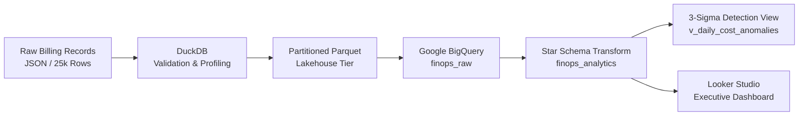

# Cloud FinOps Lakehouse & Cost Anomaly Detection Engine

An end-to-end cloud financial operations (FinOps) platform built to ingest, model, and monitor multi-cloud billing logs. Features partitioned lakehouse storage, dimensional star schema modeling in BigQuery, and statistical 3-sigma anomaly detection for unbudgeted cloud spend spikes.

---

## Architecture Overview



---

## Core Capabilities

- **Lakehouse Partitioning:** Partitions synthetic multi-cloud billing logs by `year` and `month` using DuckDB into an optimized columnar Parquet dataset.
- **Dimensional Modeling (Star Schema):** Normalizes flat billing records into an analytics-ready warehouse structure:
  - `fact_cloud_spend_daily`: Granular billing events and unblended dollar spend.
  - `dim_service`: Cloud services mapped to service categories (Compute, Analytics, Storage, Database).
  - `dim_tag`: JSON tag extraction detailing `environment`, `team`, `cost_center`, and compliance flags.
  - `dim_date`: Calendar date spine with day-of-week, weekend, and fiscal period attributes.
- **Statistical FinOps Anomaly Detection:** Implements rolling 7-day baselines via SQL window functions (`AVG`, `STDDEV`) to calculate dynamic Z-scores and flag spend anomalies where excess spend exceeds 2.5 sigma and $200 burn.
- **Cost Allocation & Governance:** Computes tag compliance metrics and quantifies untagged resource waste across departments.

---

## Data Schema & Metrics Summary

| Layer | Object Name | Type | Purpose |
| :--- | :--- | :--- | :--- |
| **Ingestion** | `stg_cloud_billing` | Table | Raw unblended billing records (25,000 rows) |
| **Analytics** | `fact_cloud_spend_daily` | Table | Primary fact table tracking cloud spend metrics |
| **Analytics** | `dim_service` | Table | Service taxonomy and cloud provider metadata |
| **Analytics** | `dim_tag` | Table | Governance attributes extracted from resource metadata |
| **Analytics** | `dim_date` | Table | Date dimension spine |
| **Alerting** | `v_daily_cost_anomalies` | View | Rolling 7-day 3-sigma cost spike detection |
| **Reporting** | `v_finops_executive_reporting`| View | Consolidated denormalized view for BI tools |

---

## Repository Structure

```text
cloud-finops-lakehouse/
├── data/
│   ├── raw/                  # Raw synthetic billing data (Parquet)
│   └── processed/lake/       # Partitioned Parquet data lake (year/month)
├── src/
│   ├── ingestion/            # Pipeline scripts for profiling and partitioning
│   └── generators/           # Synthetic multi-cloud billing log generator
├── sql/
│   ├── star_schema_models.sql       # BigQuery dimensional DDL
│   └── anomaly_detection_view.sql   # FinOps rolling 3-sigma detection logic
└── README.md
```

---

## Quickstart

### 1. Environment Setup & Data Pipeline
```bash
# Clone the repository
git clone https://github.com/niharlad2803/cloud-finops-lakehouse.git
cd cloud-finops-lakehouse

# Setup virtual environment
python3 -m venv venv
source venv/bin/activate
pip install duckdb pandas pyarrow

# Run partitioning pipeline
python src/ingestion/partition_data.py
```

### 2. Analytics Execution
All dimensional models and anomaly views are version-controlled under `sql/`:
- `sql/star_schema_models.sql`: DDL for Star Schema creation.
- `sql/anomaly_detection_view.sql`: Windowed anomaly detection logic.
