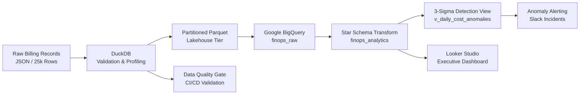

# Cloud FinOps Lakehouse & Cost Anomaly Detection Engine

An end-to-end cloud financial operations (FinOps) platform built to ingest, model, and monitor multi-cloud billing logs. Features partitioned lakehouse storage, dimensional star schema modeling in BigQuery, and statistical 3-sigma anomaly detection for unbudgeted cloud spend spikes.

---

## Architecture Overview



---

## Core Capabilities

- **Lakehouse Partitioning:** Partitions synthetic multi-cloud billing logs by `year` and `month` using DuckDB into an optimized columnar Parquet dataset.
- **Dimensional Modeling (Star Schema):** Normalizes flat billing records into an analytics-ready warehouse structure:
  - `fact_cloud_spend_daily`: Granular billing events and unblended dollar spend.
  - `dim_service`: Cloud services mapped to service categories (Compute, Analytics, Storage, Database).
  - `dim_tag`: JSON tag extraction detailing `environment`, `team`, `cost_center`, and compliance flags.
  - `dim_date`: Calendar date spine with day-of-week, weekend, and fiscal period attributes.
- **Statistical FinOps Anomaly Detection:** Implements rolling 7-day baselines via SQL window functions (`AVG`, `STDDEV`) to calculate dynamic Z-scores and flag spend anomalies where excess spend exceeds 2.5 sigma and $200 burn.
- **Automated Anomaly Alerting:** Python service that queries the local DuckDB lakehouse for cost anomalies and delivers structured Slack Block Kit incident alerts with severity classification (CRITICAL / WARNING).
- **Data Quality Gates:** Automated 8-point validation suite (record counts, schema integrity, null detection, service coverage, cost sanity, partition integrity, date range, anomaly flag presence) designed to run as a CI/CD gate.
- **CI/CD Pipeline:** GitHub Actions workflow for daily automated pipeline execution with data generation, partitioning, quality validation, anomaly detection, and artifact upload.
- **Cost Allocation & Governance:** Computes tag compliance metrics and quantifies untagged resource waste across departments.

---

## Data Schema & Metrics Summary

| Layer | Object Name | Type | Purpose |
| :--- | :--- | :--- | :--- |
| **Ingestion** | `stg_cloud_billing` | Table | Raw unblended billing records (25,000 rows) |
| **Analytics** | `fact_cloud_spend_daily` | Table | Primary fact table tracking cloud spend metrics |
| **Analytics** | `dim_service` | Table | Service taxonomy and cloud provider metadata |
| **Analytics** | `dim_tag` | Table | Governance attributes extracted from resource metadata |
| **Analytics** | `dim_date` | Table | Date dimension spine |
| **Alerting** | `v_daily_cost_anomalies` | View | Rolling 7-day 3-sigma cost spike detection |
| **Reporting** | `v_finops_executive_reporting`| View | Consolidated denormalized view for BI tools |

---

## Repository Structure

```text
cloud-finops-lakehouse/
├── .github/
│   └── workflows/
│       └── daily_finops_pipeline.yml  # CI/CD: daily automated pipeline
├── data/
│   ├── raw/                           # Raw synthetic billing data (Parquet)
│   └── processed/lake/                # Partitioned Parquet data lake (year/month)
├── src/
│   ├── alerts/
│   │   └── anomaly_notifier.py        # Automated Slack anomaly alerting service
│   ├── quality/
│   │   └── data_validator.py          # Data quality gate checks
│   ├── ingestion/
│   │   ├── generate_billing_data.py   # Synthetic billing log generator
│   │   └── partition_data.py          # DuckDB lakehouse partitioning pipeline
│   └── transforms/
│       └── inspect_data.py            # Parquet inspection utility
├── sql/
│   ├── star_schema_models.sql         # BigQuery dimensional DDL
│   └── anomaly_detection_view.sql     # FinOps rolling 3-sigma detection logic
├── requirements.txt
└── README.md
```

---

## Quickstart

### 1. Environment Setup & Data Pipeline
```bash
# Clone the repository
git clone https://github.com/niharlad2803/cloud-finops-lakehouse.git
cd cloud-finops-lakehouse

# Setup virtual environment
python3 -m venv venv
source venv/bin/activate
pip install -r requirements.txt

# Generate synthetic billing data
python src/ingestion/generate_billing_data.py

# Run partitioning pipeline
python src/ingestion/partition_data.py
```

### 2. Data Quality Validation
```bash
# Run the 8-point quality gate
python -m src.quality.data_validator
```

### 3. Anomaly Detection & Alerting
```bash
# Dry-run mode (preview anomalies, write JSON report)
python -m src.alerts.anomaly_notifier --dry-run

# Live mode (send Slack alerts)
export SLACK_WEBHOOK_URL="https://hooks.slack.com/services/..."
python -m src.alerts.anomaly_notifier
```

### 4. Analytics Execution
All dimensional models and anomaly views are version-controlled under `sql/`:
- `sql/star_schema_models.sql`: DDL for Star Schema creation.
- `sql/anomaly_detection_view.sql`: Windowed anomaly detection logic.

---

## CI/CD Pipeline

The GitHub Actions workflow (`.github/workflows/daily_finops_pipeline.yml`) automates the full pipeline:

| Step | Description | Failure Mode |
| :--- | :--- | :--- |
| Generate Data | Creates 25k synthetic billing records | Blocks pipeline |
| Partition Pipeline | DuckDB Hive-style partitioning | Blocks pipeline |
| Data Quality Gate | 8-point validation suite | Blocks pipeline |
| Anomaly Detection | Rolling 3-sigma detection (dry-run) | Continue on error |
| Upload Artifacts | Anomaly report JSON (30-day retention) | Always runs |
| Pipeline Summary | Markdown summary on workflow run page | Always runs |

**Triggers:** Daily at 08:00 UTC, manual dispatch, push/PR to `main` on `src/`, `sql/`, or `requirements.txt` changes.

**Slack Alerts (optional):** Add `SLACK_WEBHOOK_URL` as a repository secret to enable live Slack alerting in the pipeline.
